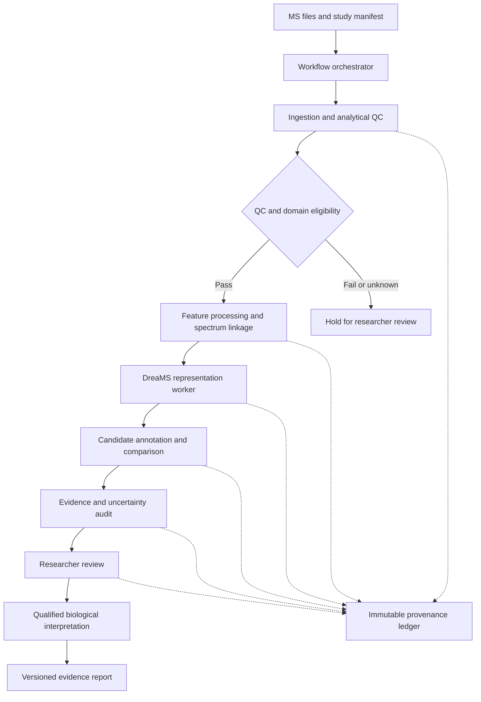

# Machine Learning in Computational Biology

**Da Vinci's Poet | Mass spectrometry research and agent architecture**

Turning MS measurements into traceable molecular evidence.

This repository connects a critical review of **DreaMS** with a proposed architecture for agent-assisted analysis of **small-molecule LC–MS/MS data**. The central question is practical: how can learned spectral representations improve annotation while preserving analytical quality, uncertainty and provenance?

**Status: research synthesis and design specification.** There is no executable analysis pipeline, trained model, new experimental dataset or reproduced benchmark in this repository. The agent architecture is our proposal; it is not a system reported or validated by the DreaMS authors.

## Start here

| Document | Purpose |
| --- | --- |
| [DreaMS research review](docs/DREAMS_REVIEW.md) | Methods, quantitative findings, limitations and full attribution |
| [MS agent architecture](docs/AGENT_ARCHITECTURE.md) | Components, tool boundaries, routing, review and failure handling |
| [Data and evidence contracts](docs/DATA_CONTRACTS.md) | What every result must retain for audit and reproduction |
| [Evaluation plan](docs/EVALUATION.md) | Baselines, leakage controls, external validation and acceptance criteria |
| [References](REFERENCES.md) | Primary paper and authors' resources |

## Scientific foundation

Bushuiev and colleagues introduced DreaMS, a transformer trained on unannotated MS/MS spectra and adapted to annotation tasks. Their work provides the scientific starting point; the [review](docs/DREAMS_REVIEW.md) distinguishes the authors' findings from our interpretation. [Bushuiev et al., Nature Biotechnology](https://doi.org/10.1038/s41587-025-02663-3).

A useful workflow must distinguish **spectral similarity**, **candidate annotation**, **confirmed identity**, **quantitative abundance** and **biological interpretation**. Improvement in one does not establish the others.

## Proposed system at a glance

The orchestrator schedules bounded tasks. Numerical tools perform signal processing, inference and statistics. An optional language model can retrieve evidence and draft explanations from approved records; it cannot invent peaks, change scores or declare molecular identity. [Detailed design](docs/AGENT_ARCHITECTURE.md).

## Initial scope

- Small-molecule, positive-mode, singly charged LC–MS/MS spectra suitable for the selected DreaMS checkpoint.
- Separate analytical QC for blanks, pooled controls, replicate behavior and acquisition batches.
- Candidate ranking with explicit abstention and traceable source spectra.
- Biological interpretation only after identity uncertainty and study-design limitations are carried forward.

Negative-mode data, multiply charged spectra, proteomics and unresolved DIA mixtures require separately evaluated routes. This initial design does not imply DreaMS is validated for those settings.

## Planned development

1. Define and validate data contracts using clearly synthetic fixtures.
2. Implement deterministic ingestion, metadata validation and provenance.
3. Integrate a pinned upstream DreaMS checkpoint and a baseline search workflow.
4. Evaluate on held-out reference spectra and an independent acquisition dataset.
5. Add evidence-constrained reporting, then assess whether agent coordination improves review quality or efficiency.

Each stage requires evidence before the next capability is claimed. See the [evaluation plan](docs/EVALUATION.md).

## Credit and independence

Prepared by [Mark Kakembo](https://github.com/markkakembo) for **Da Vinci's Poet**. Expanded from the [earlier research note](https://github.com/markkakembo/Genomics-plays/blob/main/docs/research/DREAMS.md).

DreaMS, GeMS, DreaMS Atlas and the reported experiments are the work of **Roman Bushuiev, Anton Bushuiev, Raman Samusevich, Corinna Brungs, Josef Sivic and Tomáš Pluskal**. This repository is independent commentary and architecture design, not a fork or an affiliated project. Upstream software, model weights, datasets and the paper retain their own licenses and citation requirements.

Updated: 16 November 2026.
